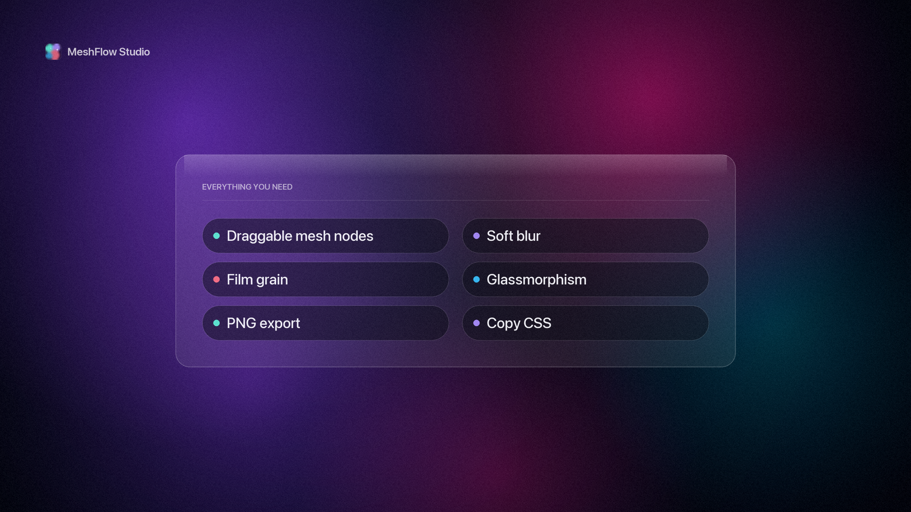
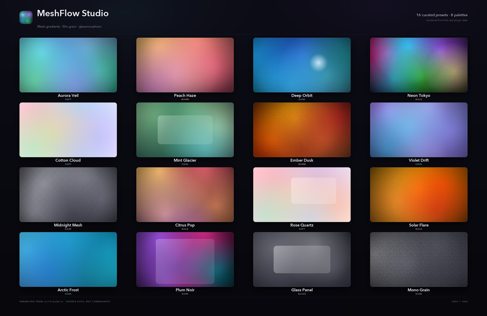
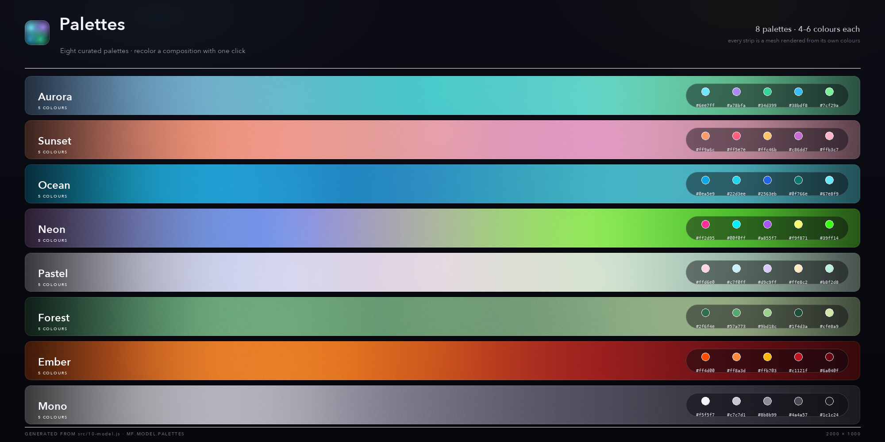

# MeshFlow Studio

**A mesh-gradient, blur, grain and glassmorphism design studio for the DeepSeek Harness Web UI.**
Sculpt soft colour fields with draggable mesh nodes, stack film grain and vignette, drop a frosted
glass card on top, then export a production-ready PNG or copy the whole composition as CSS or JSON.

[](LICENSE)
[](#verification)
[](https://github.com/hemanth090/meshflow-studio)
[](https://nodejs.org)
[](CONTRIBUTING.md)
[](https://github.com/hemanth090/meshflow-studio/stargazers)

[](docs/media/intro.mp4)

▶ **[Watch the 12-second intro](docs/media/intro.mp4)** (silent, 1080p) · [poster](docs/media/poster.png) ·
[1:1 cut for social](docs/media/intro-square.mp4) · [media kit & captions](docs/media/README.md)

MeshFlow Studio turns the fiddly craft of “a beautiful background” into a two-minute studio session:
pick a curated preset, drag a few nodes, tune blur, grain and glass, then ship the pixels or the CSS.
It runs **inside the Harness Web UI as a first-class panel**, not a separate web app, so it follows
your theme, your locale and your keyboard, and its state survives a reload.

## Gallery

All artwork below is rendered from the plugin’s real `MF.model.PRESETS` / `MF.model.PALETTES` data with
the same pipeline the canvas engine uses, not retouched mockups.

[](docs/showcase/presets-contact-sheet.png)

[](docs/showcase/palette-wall.png)

## Features

| Compose | Style | Ship |
|---|---|---|
| **2–12 mesh nodes:** position, radius, opacity, colour | **Soft blur** (0–100) over the blob layer | **PNG** at 1× / 2× / 4× (up to 6400×3600) |
| **16 curated presets** in six tags, searchable rail | **Film grain:** amount, tile scale, seed, blend mode | **Copy PNG** via the async clipboard API |
| **8 curated palettes** + one-click recolour | **Vignette:** amount and size | **Copy CSS:** layered gradients, grain data-URI, glass rule |
| **Deterministic Randomize** (seeded) | **Glassmorphism card:** position, size, radius, backdrop blur, tint, border, sheen | **Copy / download JSON:** the full composition state |
| **8 aspect ratios** from 16:9 to 9:16 and A4 | **Blend modes:** normal, screen, overlay, soft-light, lighter | **Download CSS** for the next project |

Workflow extras: **undo/redo** (80 entries, one per drag, slider scrubs coalesced), **custom user
presets**, **autosave** to `localStorage`, **keyboard shortcuts**, **light/dark themes** and **English +
Chinese** localization.

## Install

MeshFlow Studio is a DSH bundle (`@local/meshflow-studio`) with a Client half, so it needs the Harness
Web UI and nothing else. There are no runtime npm dependencies: the browser bundle only asks the
Harness module table for `react`.

### Managed install (recommended)

```sh
cd meshflow-studio
node build.mjs        # writes the generated client.js (required before installing)
```

Then install it as a bundle from a Harness agent session:

```text
plugin_manager install_bundle  target: /absolute/path/to/meshflow-studio
```

The bundle’s `cordis.patch.yml` inserts the `meshflow-studio` Loader row. The install result should
report `application: applied`; refresh the Web UI page afterwards so the new client bundle loads,
then open the studio from the sidebar panel list, the main-panel switcher, or the composer launcher.

### Manual install

1. Build `client.js` (`node build.mjs`).
2. Make the `meshflow-studio` directory resolvable by the DSH profile (copy or link it).
3. Ensure the profile composition contains the row from `cordis.patch.yml`
   (`id: meshflow-studio`, `name: '@local/meshflow-studio'`) and reload the Harness page.

No host services, tools, network requests or credentials are involved; `index.js` intentionally
exports an empty `apply()` because the plugin is pure client UI.

## Where it lives in the Harness Web UI

| Slot | Contribution |
|---|---|
| `sidebar.panellist` | Panel icon (id `meshflow-studio`, order 20) that opens the studio as a main panel. |
| `main` | The studio itself, keyed `meshflow-studio`: header, preset rail, artboard, inspector, status bar. |
| `conversation.input.left` | Compact “MeshFlow” launcher that calls `layout.selectPanel('meshflow-studio')`. |

The page is a three-column workstation (preset rail · artboard · inspector) that collapses to one
column below ~1080 px. All chrome is painted with `--dsw-alias-*` theme tokens (light and dark themes
both work); literal colours only ever belong to the artwork itself.

## Using the studio

**Compose.** Pick a preset, drag nodes on the artboard, double-click to add a node, `Delete` to remove
one. The inspector's **Mesh** tab exposes the selected node's colour, size, opacity, X/Y, the base
colour, the blend mode and the palette recolour action.

**Style.** **Effects** adds blur, grain (amount, scale, seed, blend) and vignette. **Glass** turns the
composition into a glassmorphism hero: drag the card with the position/size sliders, then tune
radius, backdrop blur, opacity, tint, border and sheen.

**Ship.** **Export** offers 1× / 2× / 4× PNG (with the exact output dimensions), Copy PNG, Copy CSS,
Copy JSON, Download CSS and Download JSON. The header carries the two most-used actions: Copy CSS and
Export PNG.

### Keyboard shortcuts

| Keys | Action |
|---|---|
| `R` | Randomize the composition (seeded) |
| `Mod+Z` / `Mod+Shift+Z` (`Ctrl+Y`) | Undo / redo |
| `Delete` / `Backspace` | Remove the selected node |
| `Escape` | Deselect |
| `↑ ↓ ← →` | Nudge the selected node by 0.005 (`Shift` ×4) |

Shortcuts are ignored while typing in a field, and only the listed keys are claimed.

## Export details

- **PNG** filenames come from `MF.model.filename`, e.g. `meshflow-aurora-veil-3200x1800.png`;
  1× / 2× / 4× scale the artboard dimensions.
- **Copy CSS** emits a self-contained, framework-free block: a base colour, a `::before` layer of
  `radial-gradient()`s with `filter: blur()`, a seeded `feTurbulence` grain overlay as a data-URI, an
  optional vignette, and a `.meshflow-glass` rule with `backdrop-filter` when glass is enabled.

<details>
<summary><strong>See an exported composition (CSS)</strong></summary>

```css
/* MeshFlow Studio - Neon Tokyo (1600 × 900) */
.meshflow-art {
  position: relative;
  isolation: isolate;
  overflow: hidden;
  background-color: #070711;
}

.meshflow-art::before {
  content: "";
  position: absolute;
  inset: -18%;
  background-image:
    radial-gradient(ellipse 58% 66% at 22% 30%, #ff2d95 0%, rgba(255, 45, 149, 0) 72%),
    radial-gradient(ellipse 64% 58% at 74% 64%, #00f0ff 0%, rgba(0, 240, 255, 0) 72%),
    radial-gradient(ellipse 52% 62% at 48% 82%, #9f87f1 0%, rgba(159, 135, 241, 0) 72%);
  filter: blur(46px);
  transform: translateZ(0);
}

.meshflow-art::after {
  content: "";
  position: absolute;
  inset: 0;
  mix-blend-mode: overlay;
  opacity: 0.22;
  pointer-events: none;
  background-image: url("data:image/svg+xml,%3Csvg xmlns='http://www.w3.org/2000/svg' width='160' height='160'%3E…%3C/svg%3E");
}
```

</details>

- **Copy PNG** uses `ClipboardItem` with `image/png`. Browsers without it (or without permission /
  a secure context) report the action as unavailable instead of throwing.
- **Copy text** uses `navigator.clipboard.writeText` with a hidden-textarea fallback.
- Every export helper is defensive: no browser API is touched until an action is invoked, nothing
  throws, and no anchor/textarea is left behind.

## Persistence

| Key | Contents |
|---|---|
| `meshflow-studio.state.v2` | Current composition (serialised envelope, restored via `MF.model.deserialize`). |
| `meshflow-studio.presets.v1` | User presets: `{ id, name, state, createdAt }[]`. |

Corrupt or foreign values are ignored; clearing these keys resets the studio.

## Architecture

The plugin ships as one generated browser bundle whose factory attaches a single shared `MF`
namespace. `build.mjs` concatenates nine plain-JS fragments in order and owns the factory wrapper:

```
00-prelude  →  10-model  →  20-engine  →  25-exporter
            →  30-controls  →  40-panels  →  50-studio  →  60-register  →  client.js
```

| Piece | Responsibility |
|---|---|
| `MF.model` | Pure composition state: aspects, limits, palettes, 16 presets, `normalize`, seeded `randomize`, `toCSS` / `toJSON`, colour maths. No DOM. |
| `MF.engine` | Canvas pipeline: base fill → blob layer (radial gradients) → mix composite → blur → vignette → grain tile → glass card → guides. Cached layers, DPR-aware, 8192 px export cap. |
| `MF.exporter` | PNG download, clipboard text/image, CSS/JSON copy and file downloads - every optional browser API guarded. |
| `MF.ui` | Presentational controls (button, slider, toggle, segmented, colour field, tabs, …) with theme-token styling and full keyboard support. |
| `MF.panels` | Preset rail with live thumbnails, layer list, and the Mesh / Effects / Glass / Export inspector. |
| `MF.Studio` | The page: state + history, canvas rendering, node dragging, shortcuts, persistence, export wiring. |
| `60-register` | Locale namespace (en + zh) and the three slot contributions. |

Read the full walkthrough in **[docs/ARCHITECTURE.md](docs/ARCHITECTURE.md)**, and the authoring rules
in **[CONTRACT.md](CONTRACT.md)**.

### Generated bundle rule

`client.js` is generated - never edit it by hand. Edit `src/*.js`, then run `node build.mjs`. CI
rebuilds and fails if the committed bundle drifts from the sources.

## Development

Requirements: **Node.js 20+** (developed on Node 24). No npm dependencies.

```sh
node build.mjs                 # build client.js (8,505 lines / 249,118 bytes)
node --check src/10-model.js   # syntax-check any fragment (all 8 are standalone-checkable)
node --test test/*.mjs         # model + engine + exporter + bundle integration tests (69)
```

| File | Role |
|---|---|
| `src/00-prelude.js` | Shared `MF` namespace, `MF.util` helpers, `MF.cssAll()`. |
| `src/10-model.js` | `MF.model`: pure state logic, palettes, presets, CSS/JSON codegen. |
| `src/20-engine.js` | `MF.engine`: canvas renderer and export canvases. |
| `src/25-exporter.js` | `MF.exporter`: downloads and clipboard. |
| `src/30-controls.js` | `MF.ui`: React primitives + `MF.ui.css`. |
| `src/40-panels.js` | `MF.panels`: studio side panels + `MF.panels.css`. |
| `src/50-studio.js` | `MF.Studio`: the main panel page + `MF.studioCss`. |
| `src/60-register.js` | Locale + slot registration; assigns `MF.clientPlugin`. |
| `test/*.mjs` | 69 `node:test` cases, including a VM-loaded bundle integration test. |
| `locale/*.json` | Host-side display metadata (`meta.title` / `meta.description`); runtime dictionaries are merged into the bundle. |
| `docs/`, `.github/`, `LICENSE`, `CONTRIBUTING.md` | Architecture, media, CI and community files. |

Adding a preset, palette or string is documented step by step in **[CONTRIBUTING.md](CONTRIBUTING.md)**.
The test suite is intentionally dependency-free: it loads the fragments in `node:vm` with stubs and
checks behaviour, not snapshots.

## Verification

Run on 2026-11-02 with Node 24.22.1 on macOS (Apple Silicon).

| Check | Command / method | Result |
|---|---|---|
| Fragment syntax | `node --check` on all 8 `src/*.js` fragments | **PASS** |
| Model tests | `node --test test/model.test.mjs` | **28 / 28 pass** |
| Engine tests | `node --test test/engine.test.mjs` | **17 / 17 pass** |
| Exporter tests | `node --test test/exporter.test.mjs` | **18 / 18 pass** |
| Bundle integration | `node --test test/integration.test.mjs` | **6 / 6 pass** |
| Full suite | `node --test test/*.mjs` | **69 / 69 pass**, 0 fail |
| Build | `node build.mjs` | 8,505 lines / 249,186 bytes, sha256 `339b625e…` |
| Bundle freshness | fresh rebuild vs committed `client.js` | **byte-identical** (`cmp` clean) |
| Install | `plugin_manager install_bundle` | **`application: applied`**, 0 warnings, `@local/meshflow-studio@1.0.0` |
| Host row | `Config.listConfigs` filter `@local/meshflow-studio` | **PASS:** row `include:meshflow-studio` (no `Config` schema, as expected) |
| Sidebar registration | Client `Slots.listSubTree` root `sidebar.panellist` | **PASS:** occupant id `meshflow-studio`, order 20, active |
| Main panel registration | Client `Slots.listSubTree` root `main` | **PASS:** occupant key `meshflow-studio`, active |
| Composer launcher | Client `Slots.listSubTree` root `conversation.input.left` | **PASS:** occupant id `meshflow-studio-launcher`, order 30, active |
| Independent audit | bundle / static / package audit (fresh `node:vm` harness) | **PASS:** 72/72 + 39/39 + 22/22 checks, 0 failed; 176-key en/zh parity; zero literal chrome colours |
| Browser smoke (visual, drag, clipboard, persistence) | manual in the Harness Web UI | **not verified by tooling:** the build session had no browser control; see below |

Visual rendering, pointer drag feel, clipboard permissions, PNG/CSS/JSON downloads, persistence
across reload, real theme/language switching and the responsive collapse are deliberately **not**
claimed as machine-verified: they require a human in the running Web UI. The plugin was installed and
its three slot contributions are live; open it and treat the gallery above as the artwork reference.

## Launch media

The teaser is an **original motion-graphics render**, not a screen recording, built frame by frame
from the plugin's own preset data (see [docs/media/](docs/media/README.md)).

| Asset | Spec |
|---|---|
| [`docs/media/intro.mp4`](docs/media/intro.mp4) | 1920×1080 · 30 fps · 12 s · H.264 / yuv420p / +faststart · silent · 6.29 MB |
| [`docs/media/intro-square.mp4`](docs/media/intro-square.mp4) | 1080×1080 · same edit · silent · 4.47 MB |
| [`docs/media/poster.png`](docs/media/poster.png) | 1920×1080 hero still · 2.48 MB |

Regenerate everything with `node docs/media/dump-presets.mjs && python3 docs/media/render-video.py`.
Captions, poster alt text and a suggested X thread live in
[`docs/media/twitter-copy.md`](docs/media/twitter-copy.md).

## Contributing

PRs are welcome. See **[CONTRIBUTING.md](CONTRIBUTING.md)** for the fragment architecture rules, code
style, accessibility expectations and the PR checklist. This project follows the
**[Contributor Covenant](CODE_OF_CONDUCT.md)**. Please report security issues privately per
**[SECURITY.md](SECURITY.md)**.

## License

**[MIT](LICENSE)** © 2026 Naveen Hemanth.

MeshFlow Studio is an independent community plugin for the DeepSeek Harness Web UI. It is not
published to npm (`private: true`) and has no runtime dependency beyond the React the Harness provides.
